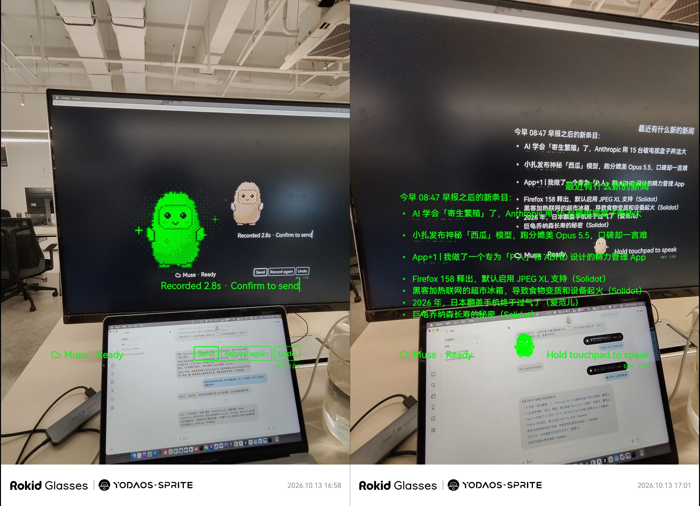
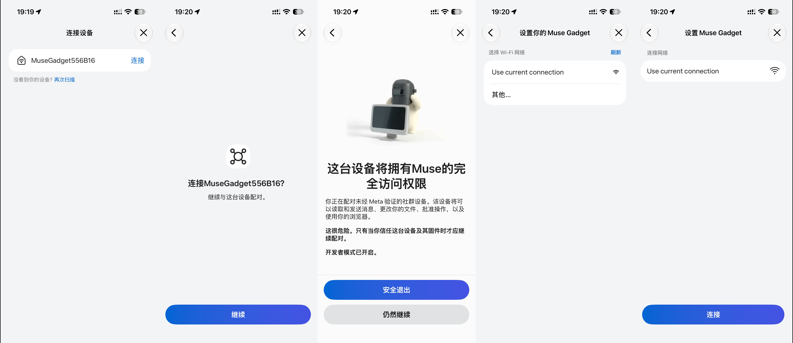

# Rokid Muse AIUI

[English](README.md) | **简体中文**

在 Rokid 眼镜上使用 Meta Muse，支持语音输入、Markdown 流式回复和动态像素头像。基于 [Muse Gadget SDK](https://github.com/facebookincubator/muse-gadget-sdk) 与 Rokid AIUI 构建，为独立集成项目。

每副眼镜拥有独立设备身份。原生组件负责 BLE 配对与安全授权交接；AIUI 经 Rokid 手机网络连接 Muse，并管理令牌刷新。日常使用无需电脑、USB 转发或眼镜 Wi-Fi。



## 安装

使用完整的 `rokid-muse-pairing` 发布文件夹，包含 APK、AIX 和安装脚本。电脑安装 Python 3、adb、aix-cli，通过 USB 连接眼镜并开启 USB 调试。在发布文件夹运行：

```bash
python3 scripts/setup.py setup
python3 scripts/setup.py open
```

1. 获取自己的 [Muse SDK token](https://gadgets.muse.ai/settings/sdk-tokens)，按脚本提示隐藏输入。
2. 在手机蓝牙设置中忽略眼镜原有连接；进入 Muse 的 **Developer mode → Add Device**，确认安装器显示的设备。
3. 关闭手机 VPN，通过 Rokid App 回连眼镜；非美国地区回连后开启并保持手机 VPN。

升级保留已有授权。安装、升级与故障排查见 [配对指南](pairing/SKILL.md)。Windows 与其他眼镜型号仍需实机验证。

### 手机配对流程

扫描设备 → 确认配对与设备访问权限 → 选择 **Use current connection** → 点击「连接」。图中设备名仅为示例，以安装器显示的名称为准。



## 使用

长按触控板录音，单击结束，选择「发送」。Muse 转写音频并返回回复；滚动阅读，双击返回。录音时长为 0.3–15 秒，发送或丢弃前仅保存在内存中。

## 常见问题

### 连接 Muse 后无法回连 Rokid App

按以下顺序尝试回连：

1. 在手机蓝牙设置中手动连接眼镜。
2. 如无法连接，在蓝牙设置中忽略已配对的眼镜，关闭再开启蓝牙；在 Rokid App 中解除眼镜配对，三击重置眼镜蓝牙，再通过 Rokid App 重新配对。
3. 如仍无法回连，再次在手机蓝牙设置中手动连接眼镜，然后通过 Rokid App 重新配对。

## 构建

macOS 需要 Node.js、Python 3、adb、aix-cli 0.10.1、JDK、Android SDK Platform 31 和 Build Tools 35.0.0。Java 依赖使用阿里 Maven 源并校验 SHA-256。

```bash
npm test
python3 scripts/build-release.py
python3 scripts/deploy-phone.py --serial <眼镜序列号>
```

发布包输出到仓库外。应用 ID 保持稳定，每次 AIX 构建更新内部版本。`--rebind` 用于修复本机授权绑定。

## 隐私与许可

SDK token、账号令牌、私钥和配对记录仅保存在本机或设备私有存储，不得提交或打包。本机授权交接回执不作为 Muse 回复。

源码采用 [Apache-2.0](LICENSE)。依赖与版权见 [Muse 及 JavaScript 依赖](THIRD-PARTY-MUSE.md)、[原生依赖](native-pairing/THIRD-PARTY.md)。使用 Muse 还须遵守其服务与 SDK 条款。
